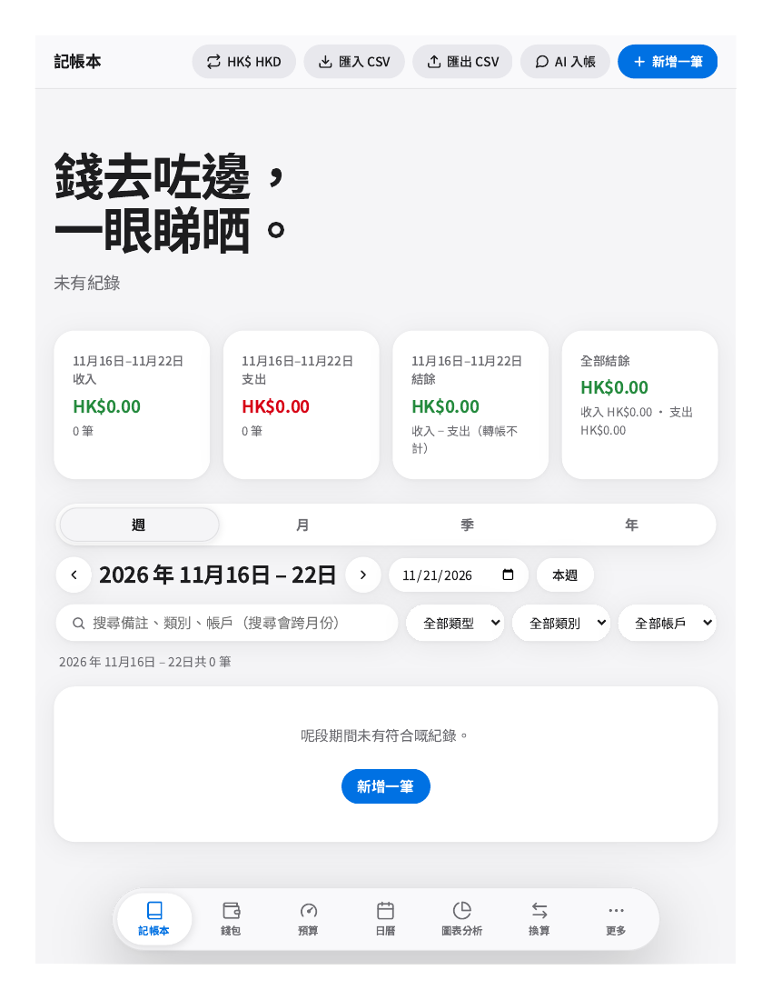
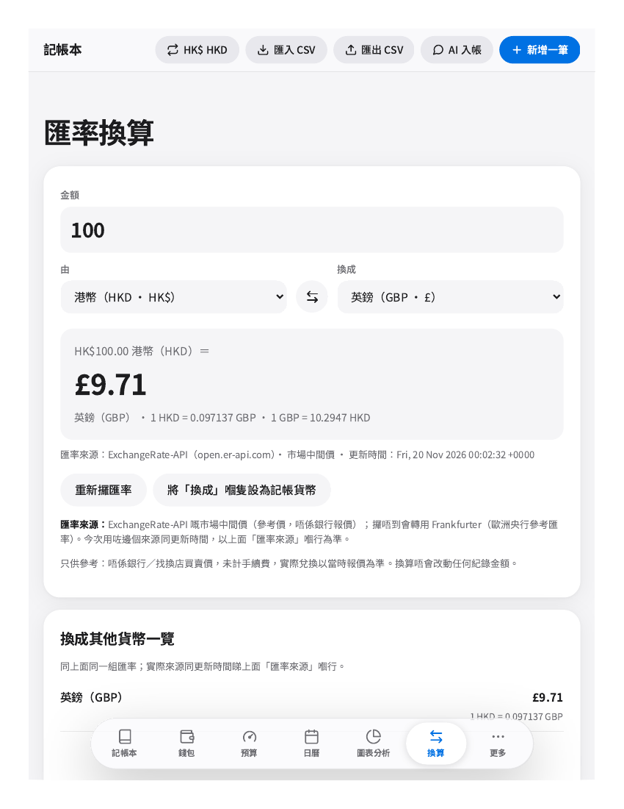
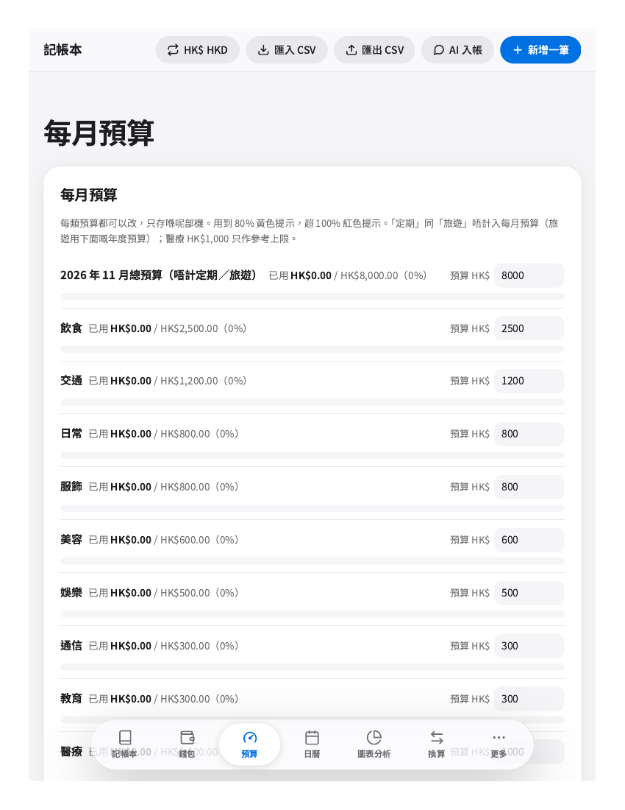
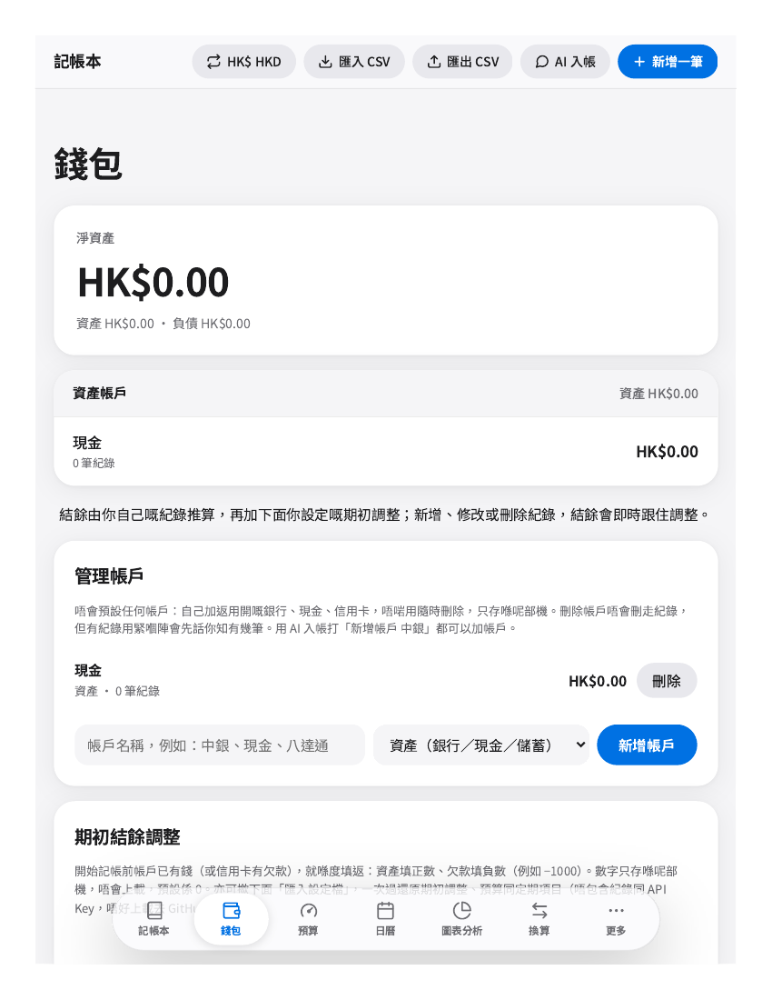

# 記帳網站

簡單記帳網站，電腦同手機都用得，唔使開會員、唔使登入。

**網站：https://clarissalo4.github.io/expense-tracker/**

## 點解整呢個

以前用開嗰個記帳 App，換電話想備份返啲紀錄，要畀錢開會員先做到。佢可以下載 CSV，咁我就自己整咗呢個網站：免費、唔使開帳戶、你啲紀錄唔會上載去任何地方，匯入 CSV 就還原返晒。

## 點用

1. 開上面條 link 就用得。
2. 第一次用係空白帳本，撳「匯入 CSV」匯入你舊記帳 App 匯出嘅 CSV，就還原返全部紀錄（支援 MoneyPlus 匯出格式，會自動跳過開頭統計區、自動去重）。拖個 CSV 檔案入頁面都得。
3. 平時記帳有三種方法：
   - 撳「＋新增一筆」手動入
   - AI chatbox：直接打「漢堡 50」，佢會自動分好支出／收入同類別，再問你用邊個帳戶，確認先入數。一次過打幾筆都得（例如「午餐 68、搭車 12、咖啡 35」）
   - 定期支出到期嗰陣撳「確認入帳」
4. 隨時撳「匯出 CSV」備份，換電話嗰陣再匯入就得。

## 有咩功能

- 記帳本：按週／月／季／年瀏覽，搜尋、按類型／類別／帳戶篩選
- 錢包：按借入／信用卡／金融卡分組睇結餘同淨資產；帳戶自己加、自己刪，冇預設帳戶；期初結餘可以匯入設定檔一次過搞掂
- 預算：獨立分頁，每月預算（預設合共 $8,000，可改）：超 80% 黃色提示，超 100% 紅色提示
- 日曆檢視：每日使咗幾多，撳入去睇返嗰日啲紀錄
- 圖表分析：按類別統計、近六個月走勢
- 換算：即時匯率換算，支援 12 種貨幣；匯率嚟自 ExchangeRate-API 中間參考價（Frankfurter／歐洲央行做後備），只供參考，唔包手續費
- 貨幣選擇：頂部按鈕或者「更多」入面轉記帳貨幣（HKD、GBP、USD、EUR、JPY、CNY、TWD、AUD、CAD、SGD、KRW、VND）。留意：轉貨幣淨係轉顯示符號，唔會自動按匯率換算啲金額；要換算金額請去「換算」分頁
- 定期支出／訂閱：到期前三日提示
- 加到主畫面：PWA，喺手機加到主畫面就當 App 用，唔使去 App Store 下載
- Gemini AI 審核：喺「更多」入面貼你自己嘅 Gemini API Key，撳「開始 AI 審核」；AI 淨係建議，每項改動都要你逐項撳「套用」先會改

## 截圖

## 私隱

- 你匯入或者新增嘅紀錄，只係存喺你自己部電話／電腦個瀏覽器入面，**唔會**上載去 GitHub，亦唔會傳去其他地方。
- Gemini API Key 都係只存喺你瀏覽器，唔會寫入網站檔案。
- 唔好將你嘅 CSV 備份檔案或者設定檔上載去呢個 repo，嗰啲先至會公開。

## 更新

網站得一個檔案 `index.html`，更新嗰陣用新版蓋過舊版就得，條 link 唔變。
